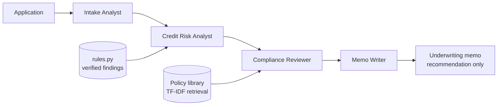

# bfsi-agent-crew

A multi-agent loan application review pipeline built on [CrewAI](https://github.com/crewAIInc/crewAI), with retrieval over a written policy library and a fully offline mode.

Four agents review an application in sequence and produce an underwriting memo that cites the policy behind every finding. The numbers are computed in plain Python. The language model handles judgement and writing, not arithmetic.

> All applicants, figures and policies in this repository are synthetic. This is a demonstration of an agent architecture, not a lending tool and not financial advice.

## Why this exists

Agent demos usually fail in the same three places: the model does arithmetic it should not, claims come with no source, and nothing runs without an API key. This project shows one way to avoid each.

- **Verified numbers.** Ratios and thresholds are calculated by tested code in `rules.py`. Agents receive them as facts.
- **Cited reasoning.** A retrieval step over `data/policies/` attaches the policy passage behind each finding.
- **Runs anywhere.** An offline pipeline mirrors the four agent roles with deterministic code, so the whole project works, and is tested, with no API key.
- **Humans stay in the loop.** Every decline or referral is routed to a human underwriter, and the memo names adverse action reasons.

## Architecture



| Role | Live (CrewAI) | Offline |
|---|---|---|
| Intake Analyst | summarises the application | `pipeline.intake` |
| Credit Risk Analyst | reasons over verified findings | `rules.evaluate` |
| Compliance Reviewer | calls the `policy_lookup` tool | `pipeline.compliance_review` |
| Memo Writer | drafts the memo | `pipeline.write_memo` |

## Quickstart

Offline, no API key needed:

```bash
git clone https://github.com/AyorN-cyber/bfsi-agent-crew.git
cd bfsi-agent-crew
pip install -e ".[dev]"
bfsi-crew review --id APP-002
pytest
```

Live with CrewAI:

```bash
pip install -e ".[live]"
cp .env.example .env        # add your model provider key
export OPENAI_API_KEY=...   # or the key your chosen model needs
bfsi-crew review --live --model gpt-4o-mini --id APP-002
```

## Example output

```text
## APP-002: Sample Applicant B

**Recommendation: REFER TO HUMAN UNDERWRITER**

| Check | Status | Detail |
|---|---|---|
| credit score | PASS | Score 701 meets the 620 minimum. |
| debt-to-income | REFER | DTI 47.1% exceeds 43% and needs manual review. |
| loan-to-value | PASS | LTV 70.0% is within the 80% limit. |
| employment history | PASS | 4 years of history meets the guideline. |

Policy references
- debt-to-income.md > Debt to income ratio limit
- fair-lending.md > Adverse action reasons

Route to a human underwriter. Items needing judgement: debt-to-income.
```

## Project layout

```text
src/bfsi_crew/
  models.py     data classes: Application, Finding, Citation, ReviewReport
  rules.py      deterministic policy checks and the combined decision
  rag.py        dependency-free TF-IDF retrieval over data/policies
  pipeline.py   offline pipeline that mirrors the four agent roles
  crew.py       CrewAI agents, tasks and the policy_lookup tool
  cli.py        bfsi-crew command
data/
  policies/     the synthetic policy library (Markdown, split at ## headings)
  sample_applications.json
tests/          rules boundaries, retrieval quality, pipeline and CLI
```

## Status and honest limits

- The offline pipeline and the retrieval layer are covered by tests that run in CI.
- The CrewAI crew is assembled and its tool is exercised in testing, but end-to-end live runs depend on your model provider and key, and live output will vary between models.
- Retrieval is TF-IDF, which suits a small policy library. Swapping in embeddings means implementing the same `search(query, k)` method.
- Thresholds in `rules.py` mirror `data/policies/`. Change them together.

## Ideas for contributors

Good first issues, if you want to help:

- Add an embedding-based `PolicyIndex` behind the same interface.
- Add an evaluation script that compares live crew recommendations with the offline baseline across many generated applications.
- Add a `--format json` option to the CLI.
- Add more policy documents, such as income verification edge cases.

See [CONTRIBUTING.md](CONTRIBUTING.md).

## Author

Built by Ayomide Olabisi ([AyorN-cyber](https://github.com/AyorN-cyber)) with AI-assisted development. The architecture decisions, review and testing are the author's.

## License

MIT, see [LICENSE](LICENSE).
